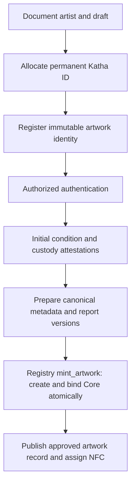

# Artwork lifecycle and independent state

Status: accepted design; account layouts and shared enums are introduced with
their implementation. Read with the [architecture overview](overview.md) and
[MVP specification](../product/mvp.md).

## State dimensions

| Dimension                         | Meaning                                                        | Authority and update rule                                      |
| --------------------------------- | -------------------------------------------------------------- | -------------------------------------------------------------- |
| Permanent identity and authorship | Which work this is and who created it                          | Registry; immutable after registration                         |
| Content publication               | Whether approved artwork content is publicly visible           | Authorized application workflow; no implied verification       |
| Verification                      | Whether Katha authenticated the registered artwork             | Verifier-signed Registry attestation                           |
| Physical custody                  | Last attested custodian or transit state                       | Authorized custody transition; independent of listing          |
| Condition                         | Ordered inspection reports and current applicable grade        | Verifier-signed versioned reports                              |
| Resale approval                   | Eligibility for the current owner and custody facts            | Derived from current anchored inspection and configured policy |
| Digital ownership                 | Current owner of the bound unique asset                        | Core; validated live when executing a sale                     |
| Listing                           | Sale terms, active/cancelled/purchased state, effective expiry | Marketplace; no implied physical movement                      |

Registration, verification, inspection-pending, and resale-approved describe other
dimensions; they are not physical custody states. Custody records describe Katha
custody, a recorded owner/custodian, or transit. The absence of a custody attestation
is shown as unknown, rather than inferred from digital ownership.

A transit or custody change cannot make an artwork sale-eligible by itself. A
condition inspection does not move the work, and a listing does not authenticate it.
Sale eligibility is a predicate over these dimensions, not a universal status.

## Onboarding and minting

Document preparation and attestation can be interleaved. The diagram expresses
required dependencies: minting needs registered identity, authentication, a valid
initial condition commitment, and the intended current metadata version.

Registration preserves the artist identifier, optional creator wallet, category,
and other designated immutable identity fields. A payout wallet is a separate
requirement before sale. Retrying registration must not allocate another artwork
identity for the same pending operation.

The Core asset address is derived deterministically from the registered artwork
identity in the Registry program's namespace. The Registry signs its required CPI
through validated PDA seeds, validates the configured Core program and collection,
and binds the new asset once. A failed CPI rolls back creation and binding. A
retry must resolve the existing valid binding or fail; it cannot mint a second asset.

## Metadata revisions

Before minting, an authorized revision advances the Registry's metadata commitment.
After minting, the Registry validates the next document version and atomically
updates both the Core URI and Registry commitment. Identity and artist attribution
remain unchanged; earlier exact bytes, hashes, and attestations remain retrievable.

An uploaded document, unsigned operation, or successful simulation is not a
committed revision. A failed or expired operation leaves the previous committed
version current. The UI reports missing bytes or mismatched hashes as integrity
problems rather than silently replacing historical content.

## Listing and purchase

A listing requires a verified bound asset, an authorized current seller, configured
artist payout, a supported payment mint, acceptable current condition/custody, and
the relevant resale approval. In-transit works cannot enter an eligible sale.

The seller authorizes temporary asset-level Freeze Delegate and Transfer Delegate
authority for the listing's Marketplace PDA. Ownership stays with the seller.
The lock and listing creation succeed together. Conflicting authorities or plugin
configurations must fail validation instead of being silently overwritten.

Cancellation and expiry recovery thaw the asset and release the listing's delegate
authority in the same transaction as the listing update. Expiry makes a listing
ineligible immediately; unlocking may require a separate recovery transaction.
A cancelled or recovered listing cannot transfer the asset later.

A purchase rechecks ownership, active terms, on-chain time, configured payment mint,
token accounts, artist/treasury recipients, current custody, and inspection
eligibility. It thaws, transfers the asset, and settles payment in one transaction;
no intermediate unlocked asset is exposed between separately submitted transactions.

The delegate design follows Core's [Freeze Delegate](https://www.metaplex.com/docs/smart-contracts/core/plugins/freeze-delegate)
and [Transfer Delegate](https://www.metaplex.com/docs/smart-contracts/core/plugins/transfer-delegate)
behavior. The program harness must verify delegate release/reset and plugin state
on cancellation, expiry recovery, purchase, and attempted duplicate purchase.
[Solana transaction failure rolls back instruction state changes, while network fees may still be charged.](https://solana.com/docs/core/transactions)

The six-decimal Devnet test token uses integer amounts. The configured simulation
defaults are 1,000 basis points primary commission, 250 basis points resale
commission and 500 basis points artist resale royalty. The authority can update
the fee schedule for future listings; seller signatures commit to exact rates
and new listings snapshot them. Legacy listings retain their initialization fees.
Primary settlement sends artist proceeds after commission; secondary settlement
splits seller, artist, and treasury proceeds. Fee arithmetic, rounding, and recipient
overlap are checked independently from ownership and physical custody.

## Custody and inspected resale

| Trigger                                 | Custody effect                                            | Ownership, listing, and approval effect                                 |
| --------------------------------------- | --------------------------------------------------------- | ----------------------------------------------------------------------- |
| List a Katha-held work                  | Katha custody continues                                   | Seller remains owner; listing becomes active                            |
| Purchase a Katha-held work              | Katha custody continues                                   | Buyer becomes owner; listing is consumed                                |
| Request delivery                        | Private request only                                      | No automatic chain ownership or custody change                          |
| Authorized dispatch                     | Attest transit from the recorded custodian                | Prior custody-bound resale approval becomes inapplicable                |
| Authorized receipt                      | Attest the actual receiving custodian                     | Owner and recipient are checked independently                           |
| Request collector-held inspection       | Owner custody continues until an actual attested movement | Request alone grants no resale approval                                 |
| Approve collector-held resale           | Custody continues                                         | Inspector attestation binds approval to current owner and custody facts |
| Purchase approved collector-held resale | Existing custody continues until actual dispatch/receipt  | New digital owner; previous owner's approval is unusable                |

The current custodian may be the previous collector while the new digital owner
awaits delivery. Record the actual custody subject; do not reinterpret an
owner-custody label as possession by the current Core owner.

Collector-held approval matches the current Core owner, artwork, applicable
condition report, custody subject/revision, and inspection time. The default
validity is configurable at 30 days and checked with chain time at listing and
purchase. Changing ownership or custody invalidates the old approval even if
custody later returns to a similarly named state. An API approval flag is
insufficient without the anchored facts the Marketplace can validate.

Katha-held resale still checks current verification, condition, and custody policy.
Remaining in Katha custody does not bypass those predicates; it avoids claiming
that physical delivery or collector-held reinspection happened when it did not.

## Observed transfers and failure recovery

The indexer also observes Core transfers outside Katha Marketplace. Such a transfer
updates derived ownership and records an observed transfer, without inventing
a Katha sale, royalty payment, condition inspection, or physical delivery. A stale
listing or approval becomes ineligible when the live owner or custody facts differ.

After either primary purchase or resale, finalized history must show the actual
Core owner while preserving artist attribution and prior metadata/condition versions.
NFC continues resolving to the same permanent ID at
`https://katha.fun/art/KATHA-PAUBHA-000001`; local/LAN demonstrations use the
configured application origin until hosted deployment exists.

A failed transaction never becomes successful provenance. A successful chain
operation followed by an API/indexer outage is recovered through finalized receipt
validation, idempotent replay, and backfill. Pending work stays visibly pending
until reconciliation establishes the outcome.
