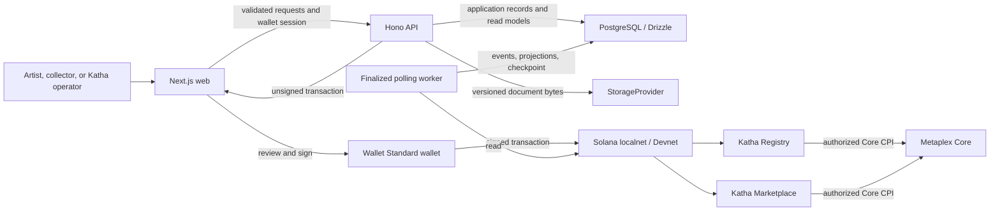

# Katha architecture

Status: accepted design for the Devnet MVP; implementation is planned.

The [MVP specification](../product/mvp.md) defines product requirements. This
document assigns responsibilities and trust boundaries. The
[artwork lifecycle](artwork-lifecycle.md) defines state changes, and
[ADR 0001](../decisions/0001-trust-and-lifecycle.md) records the decisions.

## System boundaries

The browser and incoming API requests are untrusted. Wallet authentication
authorizes an API session; transaction signatures and program constraints
independently authorize chain writes. The API never becomes a signing authority.

## Responsibility and source of truth

| Concern                             | Authoritative record                                          | Application responsibility                              |
| ----------------------------------- | ------------------------------------------------------------- | ------------------------------------------------------- |
| Artist profile and draft content    | PostgreSQL application records                                | Admin authorization and relational validation           |
| Registered identity and attribution | Registry artwork account                                      | Preserve permanent ID, artist identity, and binding     |
| Current digital owner               | Core asset account                                            | Read live ownership for sensitive decisions             |
| Verification and condition          | Registry attestations and exact hashed documents              | Display authorized claims and integrity results         |
| Recorded physical custody           | Authorized Registry custody attestations                      | Coordinate manual handling; show the last recorded fact |
| Listing and settled sale            | Marketplace accounts and successful transactions              | Quotes, wallet workflow, listing queries                |
| Historical provenance               | Successful finalized Registry, Marketplace, and Core activity | Idempotent PostgreSQL projections with freshness status |
| Shipping and private evidence       | Restricted off-chain records and storage                      | Role-based access and redacted public responses         |
| Document integrity                  | Registry hash and versioned stored bytes                      | Hash exact bytes; preserve previous versions            |

A custody attestation records an operator's physical claim. Core ownership does
not establish present physical possession. A database ownership projection must
not replace live account validation during listing or purchase.

## Planned repository responsibilities

| Location                     | Responsibility                                                                    |
| ---------------------------- | --------------------------------------------------------------------------------- |
| `apps/web`                   | Public, collector, and admin UI; wallet session and signing boundary              |
| `apps/api`                   | Validated REST API, storage/payment adapters, unsigned operations, polling worker |
| `packages/shared`            | Zod contracts, domain values, canonical document hashing                          |
| `packages/db`                | Drizzle schema, migrations, database queries                                      |
| `packages/solana`            | Kit clients, transaction builders, isolated Metaplex adapter, generated clients   |
| `programs/katha_registry`    | Bounded artwork trust records and lifecycle authorization                         |
| `programs/katha_marketplace` | Eligibility, temporary delegates, atomic settlement                               |
| `docs`                       | Product requirements, architecture decisions, setup and operating instructions    |

Turborepo orchestrates workspace tasks. The indexer stays alongside the API
codebase, with its own worker command and database checkpoint. There is no
additional queue, database, or service infrastructure in the MVP.

## Authorization boundaries

| Action                            | Required authority                                           | Independent chain enforcement                                                  |
| --------------------------------- | ------------------------------------------------------------ | ------------------------------------------------------------------------------ |
| Create profiles or edit drafts    | Authenticated admin                                          | No chain change is implied                                                     |
| Initialize platform configuration | Authorized bootstrap signer                                  | Program validates configured authority and prevents replacement initialization |
| Register an artwork               | Configured registration authority                            | Registry validates immutable identity and account derivation                   |
| Authenticate or inspect           | Configured verifier                                          | Registry validates signer, artwork, condition hash, and attestation            |
| Record custody                    | Configured custody authority                                 | Registry validates transition and current record                               |
| Mint or revise metadata           | Authorized platform role                                     | Registry validates prerequisites and controls Core update CPI                  |
| List or cancel                    | Current seller; defined expiry recovery for expired listings | Marketplace checks live Core ownership, listing, and delegate authority        |
| Purchase                          | Buyer signer                                                 | Marketplace validates listing, eligibility, token accounts, and all recipients |

Admin and verifier session roles grant API access, not arbitrary chain privileges.
Before preparing an operation, the API checks that the connected wallet can perform
the corresponding configured chain role. Programs repeat the essential checks.

Collection metadata authority is held through a Registry-controlled PDA. The
Registry's mint and metadata instructions are the intended path for setting the
Core URI and its matching commitment; unrelated update delegates must not provide
a bypass. Collector ownership remains distinct from this update authority.
[Core updates require an update authority or authorized delegate.](https://www.metaplex.com/docs/smart-contracts/core/update)

Marketplace delegate PDAs are controlled by the Marketplace program. They can act
only through validated listing, cancellation, recovery, and purchase instructions;
they are not platform wallets with unrestricted transfer rights.

## Wallet and operation flow

1. The wallet signs a one-use session challenge bound to origin, wallet, cluster,
   nonce, issue time, and expiry. The API validates it before protected writes.
2. The API validates a shared request schema, role, network configuration, live
   accounts, and operation prerequisites.
3. It records the expected operation and prepares an unsigned transaction using
   generated clients. Simulation results are advisory, not proof of success.
4. The UI presents cluster, programs, action, asset, amounts, recipients, fee payer,
   and simulation result. The authorized wallet reviews and signs.
5. The signed transaction is submitted. Expiry requires a freshly prepared
   transaction and another wallet review.
6. A receipt is accepted only after finalized success matches the expected program,
   instruction, artwork, accounts, signer, and effects. A supplied signature alone
   cannot authenticate an operation.
7. The indexer independently derives history from successful finalized activity.
   Pending operation state is kept distinct from verified artwork or sale history.

RPC data, returned account bytes, logs, metadata, and document uploads are treated
as untrusted data. Validate program owners, discriminators, lengths, PDA
relationships, collection membership, and public/private schemas before use.

## Document and indexing boundaries

Storage accepts validated content and preserves immutable version bytes. Public
metadata and condition documents omit shipping details, private evidence, and
personal information. Private records use separate access controls and responses.
A new document may exist before chain submission; it becomes the current committed
version only after the corresponding successful finalized operation.

The indexer persists decoded events, projections, and checkpoints in one database
transaction. Replay uses stable chain identities, and one Marketplace sale is
correlated with its Core transfer rather than counted twice. Backfill, retries,
gap detection, and live Core owner reconciliation expose incomplete projections.
Failed transactions and receipt callbacks cannot manufacture provenance.

## Compatibility and implementation gates

Application code is Kit-first. Umi and other compatibility types stay inside the
Metaplex adapter. Anchor IDLs feed deterministic Codama generation; generated
clients are reviewed build artifacts, never hand-maintained instruction schemas.

The selected program toolchain pairs Anchor CLI/crates 1.2.0 with Solana CLI 4.1.2,
as recommended in the [Anchor release notes](https://www.anchor-lang.com/docs/updates/release-notes/1-2-0).
Core uses its standard Rust CPI interface without older optional Anchor
integrations. Package pins are rechecked and recorded when each package is first
installed. Program builds and real Core CPI tests must pass before business logic
is added. Wallet and RPC transaction-version capability is checked explicitly.

These documents do not prove compilation or security. Implementation must verify
the PDA mint signer, collection/update authority, plugin interactions, settlement
rollback, session replay prevention, and finalized event recovery. Localnet and
Devnet are the build targets; production hosting and mainnet remain separate.
